# AVAZone

A recreation of Atari's 1980 vector arcade game **Battlezone**, built with .NET 10 and Avalonia UI. Look
out through your tank's periscope across a green wireframe plain of cubes and pyramids, under jagged
mountains, an erupting volcano and a crescent moon. Find the enemy on radar, turn to face it, and fire
before it lines up its own gun. Tanks first, then fast guided missiles, then supertanks, while a flying
saucer drifts by now and then for big points.

## Features

- **The periscope view**: first-person 3D wireframe in vector green, with the red radar and readouts
  across the top, as on the cabinet's coloured overlay.
- **The battlefield**: cubes, wide pyramids and tall pyramids scattered over a plain that wraps round,
  so it seems to go on for ever. Blocks stop tanks and shells, so they make good cover.
- **The skyline**: jagged mountains all round the horizon, a volcano that throws up lava, and a crescent
  moon. They turn as you turn.
- **One enemy at a time**, as on the cabinet:
  - **Tanks** close in, turn their gun on you and fire, and break off now and then to sidestep.
  - **Missiles** (from 10,000 points) scream in low and fast, zigzagging, and hop over obstacles.
  - **Supertanks** (from 25,000) are quicker, turn faster and fire more often.
  - **Saucers** drift about now and then. They never attack and never show on radar, but they're worth
    5,000.
- **Radar and warnings**: a sweeping radar, with *ENEMY IN RANGE*, *ENEMY TO LEFT / RIGHT / REAR* and
  *MOTION BLOCKED BY OBJECT* just as on the original.
- **The gunsight** springs open when the gun is on a target.
- **Wreckage**: destroyed tanks fly apart in tumbling pieces that fall and bounce.
- **Cracked glass**: when you're hit, the periscope shatters from where the shell struck.
- **Tread controls**: drive with the keyboard or one stick, or use both gamepad sticks as the cabinet's
  two tread levers.
- **Synthesised sound**: the engine's throb, the cannon, the radar's blip, the saucer's warble, the
  missile's whine and the crunch of breaking glass, all generated by a script you can edit.
- **Attract mode**: leave the title screen alone for 20 seconds and a computer commander plays a
  silent demonstration.
- **Top-ten high-score table** with arcade-style initials entry.
- **Any window size**: the 4:3 screen scales to fit, letterboxed. **Ctrl+S** saves a screenshot.
- **One self-contained executable** per platform: Windows, macOS and Linux on Intel/AMD and ARM.

## Screenshots

| Title screen | An enemy tank | Enemy to rear |
|:------------:|:-------------:|:-------------:|
| 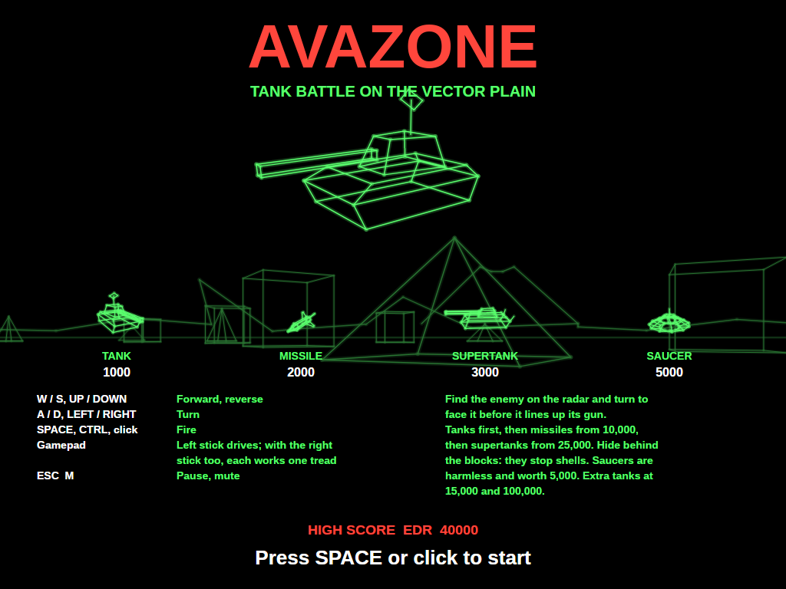 | 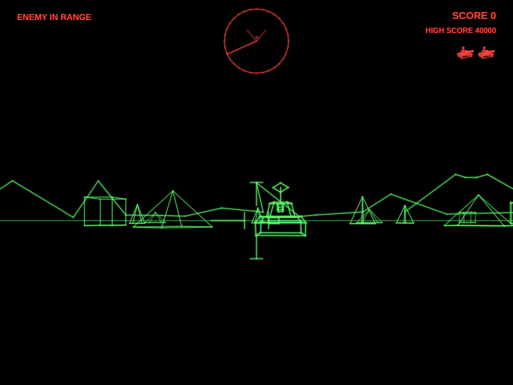 | 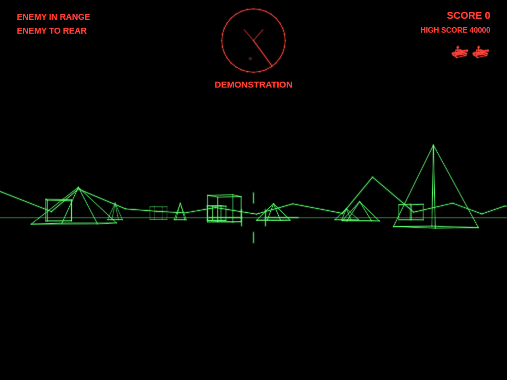 |
| The battlefield turns slowly behind the title, the enemies and their points. | A tank turns its gun on you; the sight springs open because yours is on it. | The radar shows the enemy behind, and the warnings say so. |

| Missile | Supertank | Saucer |
|:-------:|:---------:|:------:|
| 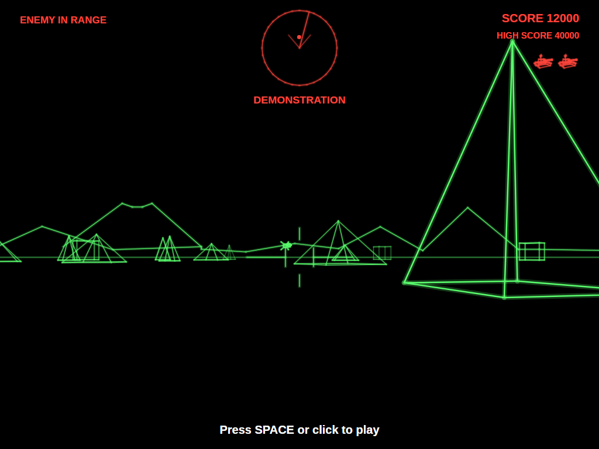 | 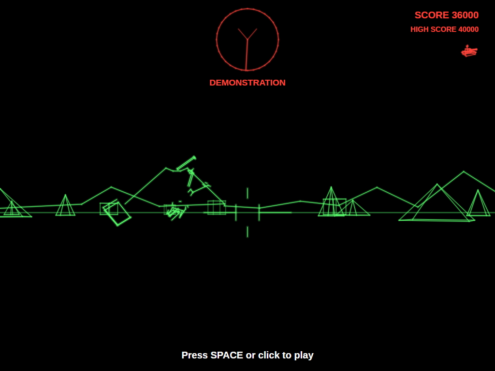 | 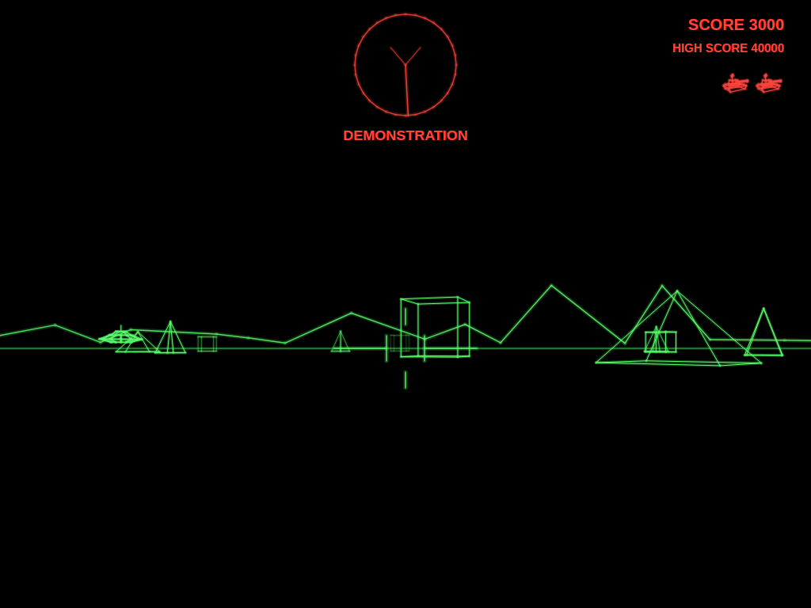 |
| A guided missile zigzags in, low over the ground. | Faster, sharper and more aggressive. | Harmless, off the radar, and worth 5,000. |

| Wreckage | Hit | Attract mode |
|:--------:|:---:|:------------:|
| 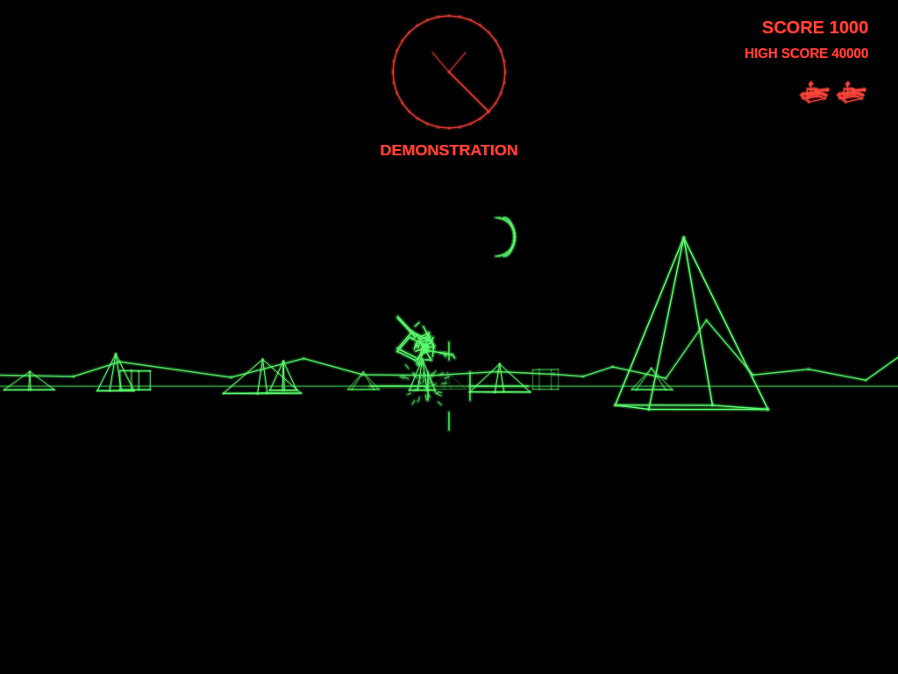 | 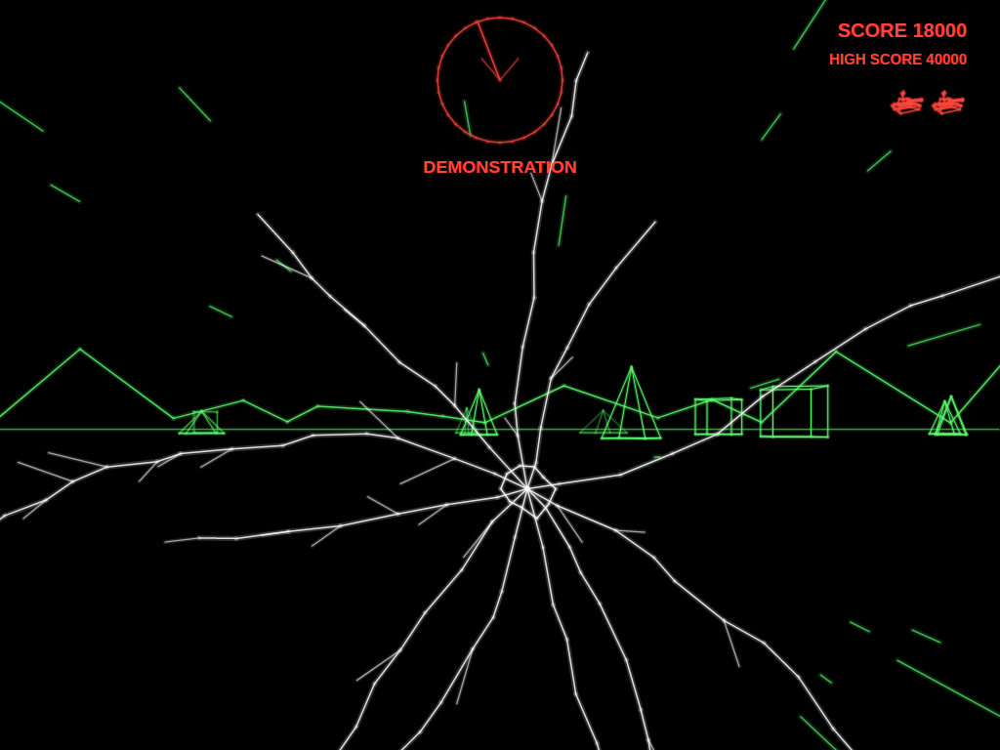 | 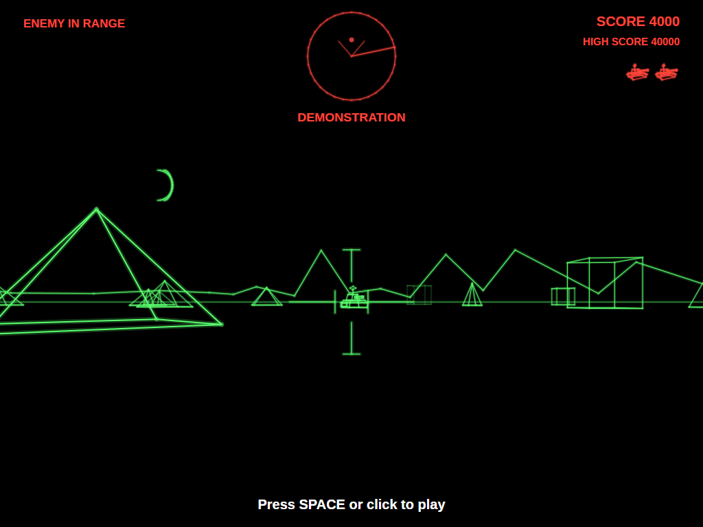 |
| A destroyed tank flies apart in tumbling pieces. | A shell through the periscope. | Left alone, the game plays itself, silently. |

| Game over | Entering initials | The high-score table |
|:---------:|:-----------------:|:--------------------:|
| 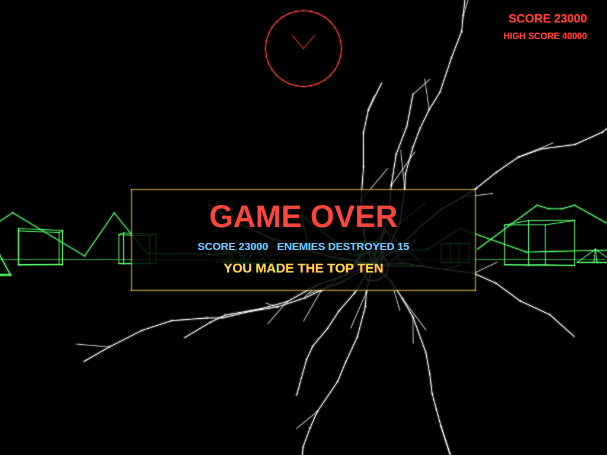 | 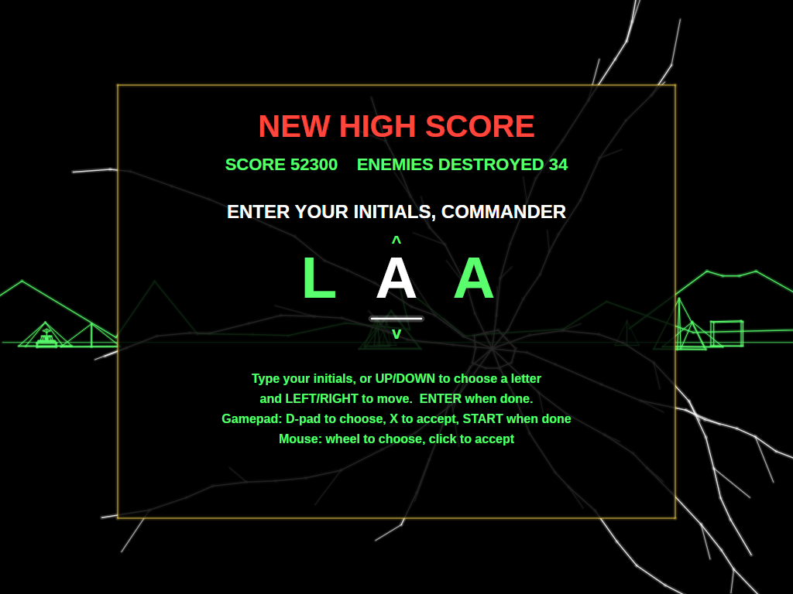 | 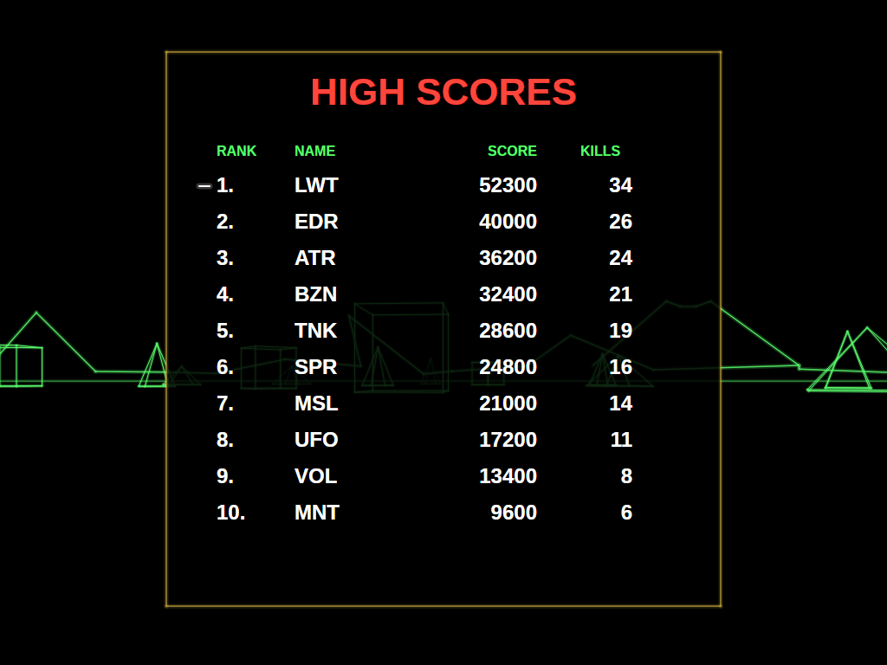 |
| The last tank is gone. | A score that makes the top ten earns three initials. | The new entry flashes in the table. |

## Download and run

Ready-to-run builds for Windows, macOS and Linux, on both Intel/AMD and ARM, are on the
[Releases page](https://github.com/Harlock123/AVAZone/releases). **Latest build** is rebuilt on every
push to `main`. Each download is one self-contained executable: no .NET install is needed.

```bash
tar -xzf AVAZone-linux-arm64.tar.gz     # or linux-x64, linux-arm, osx-arm64, osx-x64
./AVAZone
```

On Windows, unzip `AVAZone-win-x64.zip` (or `-win-arm64`, `-win-x86`) and run `AVAZone.exe`. On macOS,
if Gatekeeper refuses to open it, run `xattr -d com.apple.quarantine AVAZone` once.

### Linux: sound and gamepads

- **Sound** needs `aplay`, from the `alsa-utils` package. Without it the game runs but is
  silent. Minimal installs (Arch, Omarchy, some Raspberry Pi images) don't include it:

  ```bash
  sudo apt install alsa-utils             # Debian / Ubuntu / Raspberry Pi OS
  sudo pacman -S --needed alsa-utils      # Arch / Omarchy
  ```

- **Gamepads** use SDL2. It is bundled for Windows, macOS and Intel/AMD Linux, but **ARM Linux builds need it
  installed**. Without it the keyboard still works; only the controller does not:

  ```bash
  sudo apt install libsdl2-dev            # Debian / Ubuntu / Raspberry Pi OS
  sudo pacman -S --needed sdl2-compat     # Arch / Omarchy
  ```

  On Debian-based systems it has to be `libsdl2-dev`: the game looks for `libSDL2.so`, which
  the runtime-only `libsdl2-2.0-0` package doesn't provide.

## Requirements

- .NET 10 SDK (to build; the released executables need nothing)
- Windows, macOS or Linux

## Building and Running

```bash
cd AVAZONE
dotnet build
dotnet run
```

## Controls

The cabinet had two levers, one for each tread: push both forward to drive, pull both back to reverse,
push one and pull the other to spin on the spot.

### Keyboard

| Key | Action |
|-----|--------|
| **W** / **Up** | Forward |
| **S** / **Down** | Reverse |
| **A** / **Left**, **D** / **Right** | Turn (on the spot, or while moving) |
| **Space** / **Ctrl** | Fire |
| **Esc** | Pause (Esc again to quit) |
| **M** | Mute all sound |

### Mouse

| Input | Action |
|-------|--------|
| **Left Button** | Fire |
| **Right Button** | Forward |

### Controller (Xbox/PlayStation/Switch Pro)

| Input | Action |
|-------|--------|
| **Left Stick** / **D-Pad** | Drive and turn |
| **Both sticks** | The cabinet's way: left stick works the left tread, right stick the right |
| **A**, **B**, **X**, **bumpers**, **triggers** | Fire |
| **Start** | Pause / Resume game |
| **Back/Select** (while paused) | Exit game |

Touch the right stick and the controls switch to twin-tread driving for as long as it's in use.

### Entering initials

| Key | Action |
|-----|--------|
| **A**–**Z**, **0**–**9**, **.** | Type a letter and move to the next |
| **Up** / **Down** | Dial the current letter |
| **Left** / **Backspace**, **Right** | Move between letters |
| **Space** | Accept the letter |
| **Enter** | Done |

Gamepad: D-pad dials and moves, **X** accepts, **Start** finishes. Mouse: the wheel dials, a click accepts.

### Other

| Key | Action |
|-----|--------|
| **Ctrl+S** / **Cmd+S** | Save screenshot to Pictures folder |

## Gameplay

### The battle

There is only ever one enemy on the field: when it's destroyed, another arrives a couple of seconds later
somewhere out of sight. Watch the radar: you're at its middle, facing up, and the V shows what the
periscope can see. The warnings tell you when the enemy is in range, and whether it's to your left, your
right or behind you.

You have one shell in the air at a time, and so does the enemy. Shells fly straight and level, and stop
dead against any block, so put a block between you and an enemy that's lining up a shot. Driving into a
block stops you (*MOTION BLOCKED BY OBJECT*).

### The enemy

| Enemy | Appears | Behaviour |
|-------|---------|-----------|
| **Tank** | From the start | Closes in, turns its gun on you, fires when it has a clear shot. Its first shots tend to go wide; it gets better. Now and then it breaks off to sidestep. |
| **Missile** | From 10,000 | Fast and low, zigzagging less as it closes, hopping over blocks. It explodes on contact. |
| **Supertank** | From 25,000 | Faster, turns quicker, fires more often and sidesteps more. |
| **Saucer** | From 2,000, now and then | Drifts about for a while and leaves. Never attacks, never on radar. |

Everything gets a little quicker and sharper as your score climbs.

### Tanks

You start with three tanks, and earn more at 15,000 and 100,000 points. A single hit destroys a tank.

## Scoring

| Target | Points |
|--------|--------|
| Tank | 1,000 |
| Missile | 2,000 |
| Supertank | 3,000 |
| Saucer | 5,000 |
| Extra tank | at 15,000 and 100,000 |

## Sound Effects

All effects are synthesised by `tools/make_sounds.py`; nothing is sampled from the original machine.

| Sound | When |
|-------|------|
| `Cannon.wav` / `EnemyCannon.wav` | Your gun / the enemy's |
| `ShellBurst.wav` | A shell stopped by a block |
| `TankBoom.wav` / `SaucerBoom.wav` | An enemy / the saucer destroyed |
| `Crunch.wav` | Your tank hit |
| `Blocked.wav` | Driving into a block |
| `RadarBlip.wav` | The radar sweep crossing the enemy |
| `NewEnemy.wav` | A new tank in the area |
| `MissileLaunch.wav` / `Missile.wav` | A missile launched / in flight (loops) |
| `Saucer.wav` | The saucer's warble (loops) |
| `Idle.wav` / `Moving.wav` | The engine, idling / with the treads turning (loops) |
| `ExtraTank.wav` | An extra tank |

## Project Structure

```
AVAZONE/
├── AVAZone.csproj, AVAZone.slnx
├── Program.cs, App.axaml(.cs), MainWindow.axaml(.cs)
├── Engine/
│   ├── GameEngine.cs          # States, the battlefield, the player's tank, shells, scoring, lives
│   ├── GameEngine.Enemies.cs  # Tanks, supertanks, missiles and the saucer
│   ├── AttractDriver.cs       # The computer commander for attract mode
│   ├── HighScoreTable.cs, InitialsEntry.cs
│   ├── InputHandler.cs        # Treads from the keyboard, mouse and gamepad
│   ├── ControllerManager.cs   # SDL2 gamepad support
│   └── SoundManager.cs        # Effects and the looping engine, missile and saucer sounds
├── Models/
│   ├── Vec3.cs, Camera.cs     # 3D points, the periscope's projection, the wrapping battlefield
│   ├── Wireframe.cs           # Tank, supertank, missile, saucer and obstacle models
│   ├── Entities.cs            # Obstacles, the enemy, the saucer, shells
│   ├── Debris.cs              # Wreckage that tumbles and falls
│   └── Explosion.cs
├── Views/
│   ├── GameCanvas.cs          # Input, game loop, overlays
│   ├── GameCanvas.World.cs    # Skyline, volcano, moon, battlefield, gunsight, cracked glass
│   ├── GameCanvas.Screens.cs  # Radar, readouts, title, entry and table screens
│   └── GameCanvas.Draw.cs     # Glow lines, text, 3D line drawing
├── Sounds/                    # Generated WAV files
├── Images/                    # README screenshots
└── tools/
    └── make_sounds.py         # Synthesises the sound effects
```

## Technical Details

- **Framework**: Avalonia UI 12.1 on .NET 10
- **Audio**: NetCoreAudio for cross-platform sound playback
- **Controller**: SDL2 GameController API for cross-platform gamepad support
- **3D**: every model is a list of lines in 3D, projected through the periscope, with lines that pass
  behind it trimmed. As in the original, the wireframes are see-through.
- **The battlefield** is a 5,000-unit square that wraps at its edges; every distance and bearing is
  taken the short way round, and nothing is drawn far enough away to straddle the wrap.
- **The skyline** is drawn at an infinite distance, so it turns with the tank but never comes nearer.
- **Rendering**: a custom `Control` with `DrawingContext`. Every line is drawn twice, wide and faint and
  then thin and bright, for a vector-monitor glow.
- **Screen**: a fixed 1024×768 screen, scaled to fit any window size with letterboxing
- **Game Loop**: 60 FPS using `DispatcherTimer`
- **High scores**: saved to `AVAZone/highscores.txt` in the user's application-data folder
  (`~/.config` on Linux, `%APPDATA%` on Windows, `~/Library/Application Support` on macOS)

## Roadmap

### Done

- The periscope view, the wrapping battlefield, the skyline with its volcano and moon
- Tanks, missiles, supertanks and saucers, radar and the cabinet's warnings
- One-shell-at-a-time gunnery, obstacles as cover, tumbling wreckage and cracked glass
- Twin-tread gamepad driving as well as simple keyboard and stick controls
- Synthesised sound, attract mode, top-ten high scores with initials, screenshots and mute
- Self-contained single-file releases for 8 platforms on every push to `main`

### Planned

- The original's 100,000-point supertank that turns and retreats
- Optional settings for starting tanks and bonus-tank scores
- Two-player alternating games

## Credits

Battlezone was designed by Ed Rotberg and released by Atari in 1980. This is a fan recreation of its
gameplay; no code, graphics or sound from the original are used. Battlezone is a trademark of its
owner, and this project is not affiliated with or endorsed by Atari.

## License

MIT License
